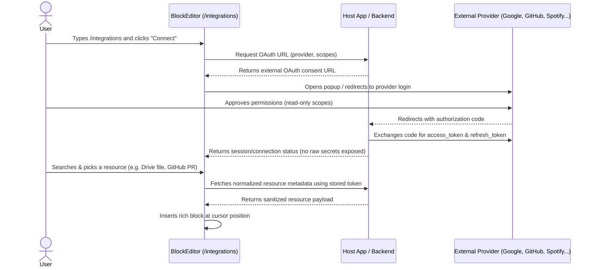

# NextGen Block Editor — `/integrations` Product & Architecture Plan

> **Status**: Product Specification & Architecture Blueprint (Planned for future release)

---

## 1. Product Vision & Value Proposition

Modern technical docs, blogs, and knowledge bases rarely live in isolation. Authors constantly switch tabs to copy links, screenshots, code snippets, or task statuses from **Google Drive, Gmail, YouTube, Spotify, GitHub, Figma, Notion, Slack, and Trello**.

The **`/integrations`** command turns `nextgen-block-editor` into a unified document workspace:
- **Zero Context Switching**: Search and insert live resources from connected services without leaving the editor.
- **Authenticated Smart Embeds**: Instead of plain hyperlinks or broken private previews, connected services resolve rich metadata (titles, thumbnails, statuses, code snippets, audio/video players) into native interactive blocks.
- **Host-Agnostic Design**: Because `nextgen-block-editor` is a reusable React library, OAuth client secrets never live in the package—the host app provides an `integrationAdapter` or OAuth endpoint, while the editor handles the UI, picker, and block rendering.

---

## 2. End-to-End OAuth 2.0 & Token Flow

Users authenticate with external services via standard **OAuth 2.0** (Authorization Code Flow with PKCE, or host-backend OAuth proxy):



### Token Management & Security Model
1. **No Secrets in Client Bundle**: OAuth `client_secret` values remain strictly on the host backend (or PKCE public client for read-only SPAs).
2. **Scoped Least-Privilege Permissions**: Request read-only scopes where possible (e.g., `drive.readonly`, `gmail.readonly`, `repo:read`, `user-read-currently-playing`).
3. **Host Adapter Interface (`IntegrationAdapter`)**:
   - `getConnections()`: Returns `{ provider, connected, accountLabel, expiresAt }[]`.
   - `connect(provider)`: Initiates OAuth popup/redirect and resolves when connected.
   - `disconnect(provider)`: Revokes/clears token on host.
   - `searchResources(provider, query)`: Returns normalized `IntegrationResource[]` items for the picker modal.
4. **Refresh & Expiry Handling**: When a token expires, the host refreshes it transparently or prompts the user with a one-click **Reconnect** badge in the `/integrations` modal.

---

## 3. Supported Service Integrations & Rich Block Rendering

Each connected service maps to a dedicated block type (or specialized variant) in `BlockEditor` and renders cleanly in `BlockRenderer` via `blocksToHtml.ts`:

| Service | Use Case | OAuth Scopes (Typical) | Rich Block Rendering in `BlockRenderer` |
| :--- | :--- | :--- | :--- |
| **Google Drive** | Attach docs, sheets, slides, PDFs | `drive.readonly` | File card with MIME icon, title, owner, last-modified date, "Open in Drive" CTA, and optional embedded preview. |
| **Gmail** | Reference key email threads in specs/notes | `gmail.readonly` | Compact email thread card showing subject, sender, date, snippet preview, and thread message count. |
| **YouTube** | Embed videos & playlists from channel/history | `youtube.readonly` | Responsive 16:9 player with alignment/size tunes, video title, channel badge, and optional timestamp start. |
| **Spotify** | Embed tracks, albums, playlists, or listening lists | `user-read-recently-played` | Native Spotify embed iframe (`open.spotify.com/embed/...`) or compact track card inside `MusicCarouselTool`. |
| **GitHub** | Link repositories, issues, PRs, or live code snippets | `repo` (or `public_repo`) | Repo/PR/Issue card with star count, open/merged status pill, language badge, and syntax-highlighted snippet preview. |
| **Figma** | Embed live design frames & prototypes | `file_read` | Interactive Figma iframe embed with frame title, last-updated timestamp, and zoom/alignment controls. |
| **Notion** | Pull reference pages or database entries | Notion OAuth (`read_content`) | Clean summary card with page icon, title, workspace breadcrumb, and excerpted block preview. |
| **Slack** | Archive key team decisions & threads in docs | `channels:history`, `search:read` | Message quote card with author avatar, channel tag (`#engineering`), timestamp, and formatted message body. |
| **Trello** | Embed project boards or task cards | `read` | Task card with board/list name, labels, due date badge, and checklist progress bar. |
| **Linear** | Track engineering issues inside RFCs | `read` | Issue pill/card with identifier (`ENG-142`), priority icon, status badge, and assignee. |
| **Discord** | Quote community announcements or threads | `identify`, `messages.read` | Styled message quote card with server/channel badge, author, and timestamp. |
| **Calendly** | Embed booking links in proposals/portfolios | `default` | Interactive booking card / inline scheduling widget with event duration and "Schedule Time" CTA. |
| **Cloudinary** | Browse & insert optimized cloud images/videos | Cloudinary Media API | High-res responsive image/video block with automatic format/compression URLs. |

---

## 4. UI / UX Architecture

### A. `/integrations` Slash Command & Modal (`IntegrationsModal.tsx`)
1. **Trigger**: Typing `/integrations` (or clicking an Integrations toolbar button) opens the **Integrations Hub Modal**.
2. **Left Sidebar (Providers)**: Lists all configured providers with live status pills (`Connected` / `Connect`).
3. **Main Pane (Resource Picker)**:
   - If **disconnected**: Shows service description, requested permissions, and a **Connect with {Provider}** button.
   - If **connected**: Shows a live search bar (`Search Drive files...`, `Search GitHub repos...`), recent items list, and **Insert Block** action.
4. **Developer Gating Compatibility**: Respects `enabledTools` / `allowToolConfiguration` so developers can restrict which integrations are available per plan (e.g., Free vs. Pro).

### B. Normalized Block Data Schema
All integration blocks can share a clean envelope in `EditorJSData`:
```ts
export interface IntegrationBlockData {
  provider: 'gdrive' | 'gmail' | 'youtube' | 'spotify' | 'github' | 'figma' | 'notion' | 'slack' | 'trello' | 'linear';
  resourceId: string;
  url: string;
  title: string;
  subtitle?: string;
  thumbnailUrl?: string;
  meta?: Record<string, string | number | boolean>;
  align?: 'left' | 'center' | 'right';
  size?: 'small' | 'medium' | 'large' | 'full';
}
```
Using a unified `IntegrationBlockData` contract lets `blocksToHtml.ts` and `shadcn.css` style all integration cards consistently in Black & White Light/Dark mode while allowing provider-specific badges and embeds.

---

## 5. Phased Implementation Roadmap

1. **Phase 1 — Core Interfaces & Modal**:
   - Define `IntegrationAdapter` & `IntegrationBlockData` in `src/types.ts`.
   - Build `IntegrationsModal.tsx` and register `/integrations` trigger tool.
2. **Phase 2 — First-Wave Providers (Media & Docs)**:
   - Wire **Spotify**, **YouTube**, **Google Drive**, and **GitHub** pickers and rich block renderers.
3. **Phase 3 — Collaboration & Design Providers**:
   - Add **Figma**, **Notion**, **Slack**, **Gmail**, and **Trello** cards.
4. **Phase 4 — Live Refresh & Demo Mock Adapter**:
   - Ship a built-in mock `IntegrationAdapter` for `editor-demo` so users can test `/integrations` out of the box without live API keys.
